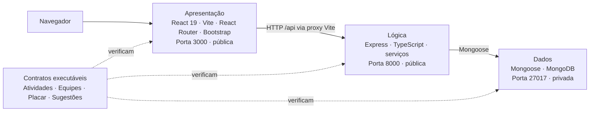

# Arquitetura do OctoFit Tracker

O OctoFit Tracker é uma aplicação de três camadas para um programa de atividades físicas escolar. O código inicial inclui contratos de API e pontos de implementação intencionalmente incompletos para que você use o modo agent do GitHub Copilot em um ciclo guiado por testes.

## Limites entre as camadas

- **Camada de apresentação**: React 19, Vite, React Router, Bootstrap e um cliente compartilhado da API em `octofit-tracker/frontend/src`.
- **Camada de lógica**: rotas e serviços Express com TypeScript em `octofit-tracker/backend/src` expõem o comportamento `/api/*` na porta `8000`.
- **Camada de dados**: modelos Mongoose e dados de demonstração em `octofit-tracker/backend/src/models` e `src/scripts/seed.ts` são persistidos no MongoDB na porta `27017`.

## Portas e regras de ambiente

- MongoDB: `27017` (privada)
- API Express: `8000` (pública)
- Interface Vite: `3000` (pública)
- O navegador acessa caminhos relativos `/api`. O Vite os encaminha para `http://localhost:8000`; `VITE_API_BASE_URL` pode substituir a URL-base.
- Não encaminhe nem torne públicas outras portas.

## Contrato da API

| Capacidade | Método e caminho | Comportamento esperado |
| --- | --- | --- |
| Registro de atividades | `GET /api/activities`, `POST /api/activities` | Lista e cria atividades válidas. POST recebe `userId`, `teamId`, `type` e `minutes`; `userId` e `teamId` devem ser IDs bem-formados de uma pessoa e uma equipe existentes, caso contrário a API retorna um 4xx intencional (nunca um 500 causado por erro de conversão). Uma atividade criada armazena `user`, `team`, `type` e `minutes` enviados, além de `points` e `occurredAt` calculados. |
| Equipes | `GET /api/teams`, `POST /api/teams` | Lista e cria equipes com integrantes. As equipes criadas e listadas mantêm os valores enviados em `name` e `mascot`. Rejeita uma equipe sem nome com `400`. |
| Placar | `GET /api/leaderboard` | Retorna as equipes ordenadas pela soma dos pontos de suas atividades, da maior para a menor. Cada item contém `teamName`, `totalPoints` e uma `rank` iniciada em 1. |
| Sugestões de treino | `GET /api/workouts/suggestions/:userEmail` | Recomenda treinos com base nos padrões de atividade recentes da pessoa correspondente ao e-mail seed. O foco da primeira sugestão (`focus`) corresponde à meta ou à atividade recente dessa pessoa, e o campo `reason` explica o motivo. Um e-mail sem pessoa correspondente retorna um 4xx intencional (por exemplo, `404`). |

## Decisões de implementação

Registre seu plano aqui antes de editar o código.

- Decisão da camada de apresentação:
- Decisão da camada de lógica:
- Decisão da camada de dados:
- Abordagem para registro de atividades:
- Abordagem para gerenciamento de equipes:
- Abordagem para o placar:
- Abordagem para sugestões de treino:

## Plano de testes

Registre os comandos executados e o significado de cada falha.

- Testes da camada de dados: `npm run test:data --prefix octofit-tracker/backend`
- Testes da API: `npm run test:api --prefix octofit-tracker/backend`
- Testes do frontend: `npm test --prefix octofit-tracker/frontend`
- Compilação do backend: `npm run build --prefix octofit-tracker/backend`
- Compilação do frontend: `npm run build --prefix octofit-tracker/frontend`

## Decisões de implementação (limites e ordem segura)

Limites entre camadas: a apresentação consome somente `/api` pelo proxy do Vite; a lógica é a única camada que acessa os modelos Mongoose; os dados não conhecem rotas nem telas.

Ordem de implementação, do menor risco ao maior acoplamento:

1. **Modelos de dados** (`octofit-tracker/backend/src/models`): tornar obrigatórios `User` (`name`, `email`, `fitnessGoal`), `Team` (`name`, `mascot`), `Activity` (`type`, `user`, `team`) e `Workout` (`focus`, `minutes`, `difficulty`). Não criar dados por scripts diretos do MongoDB; usar os modelos e o código da aplicação.
2. **API** (`octofit-tracker/backend/src`), nesta ordem, porque cada item depende do anterior:
   1. Atividades: validar `userId` e `teamId` como ObjectId existentes e responder 4xx, nunca 500.
   2. Equipes: rejeitar nome ausente com `400` e devolver `name`, `mascot` e integrantes.
   3. Placar: somar pontos por equipe, ordenar de forma decrescente e numerar `rank` a partir de 1.
   4. Sugestões de treino: responder `404` para e-mail sem pessoa correspondente e justificar `focus` com `reason`.
3. **Frontend** (`octofit-tracker/frontend/src`), depois que o contrato da API estiver estável:
   1. Estados de carregamento, erro (`role="alert"`) e vazio nas rotas `/activities`, `/teams`, `/leaderboard` e `/workouts`.
   2. Exibição dos dados retornados pela API em cada rota.
   3. Sugestões de treino para uma pessoa específica, substituindo "Implementação pendente".
4. **Builds**: compilar o backend e o frontend somente após os testes das camadas anteriores passarem.

Restrições que valem em todas as etapas: MongoDB na porta 27017 (privada), API na 8000 e Vite na 3000 (públicas); nenhuma autenticação neste exercício; textos visíveis em português do Brasil.

## Plano de testes (falhas atuais e critério de conclusão)

Comandos, a partir da raiz do repositório:

- Dados: `npm run test:data --prefix octofit-tracker/backend`
- API: `npm run test:api --prefix octofit-tracker/backend`
- Frontend: `npm test --prefix octofit-tracker/frontend`
- Builds: `npm run build --prefix octofit-tracker/backend` e `npm run build --prefix octofit-tracker/frontend`

Falhas registradas antes da implementação:

- **Dados** (`tests/data.contract.test.ts`): 4 de 5 falham. Os modelos não validam campos obrigatórios de `User`, `Team`, `Activity` e `Workout`.
- **API** (`tests/api.contract.test.ts`): 4 de 4 falham.
  - Criar e listar atividades válidas e rejeitar entradas inválidas.
  - Criar equipes, rejeitar nome ausente com 400 e expor integrantes.
  - Placar retorna lista vazia em vez de Robocats (35) e Octocats (25) na ordem correta.
  - Sugestões de treino não incluem `reason` com o padrão de atividade da pessoa.
- **Frontend** (`tests/app.contract.test.tsx`): 15 de 15 falham.
  - 12 testes de estados (carregamento, erro e vazio) nas quatro rotas.
  - 3 testes de dados: exibir atividades da API, exibir equipes, placar e sugestões, e solicitar sugestões para uma pessoa específica.

Critério de conclusão: as três suítes de teste passam sem falhas, os dois builds terminam sem erro e a configuração de portas não muda (somente 3000, 8000 e 27017, como descrito acima). Testes só devem ser alterados se o contrato documentado mudar.
